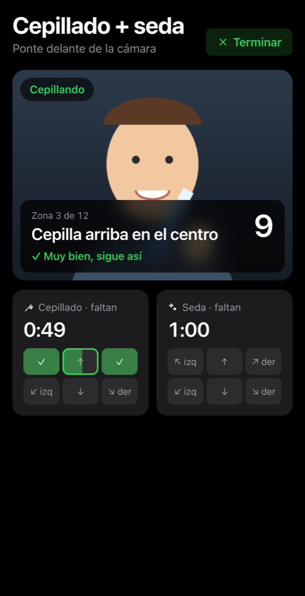
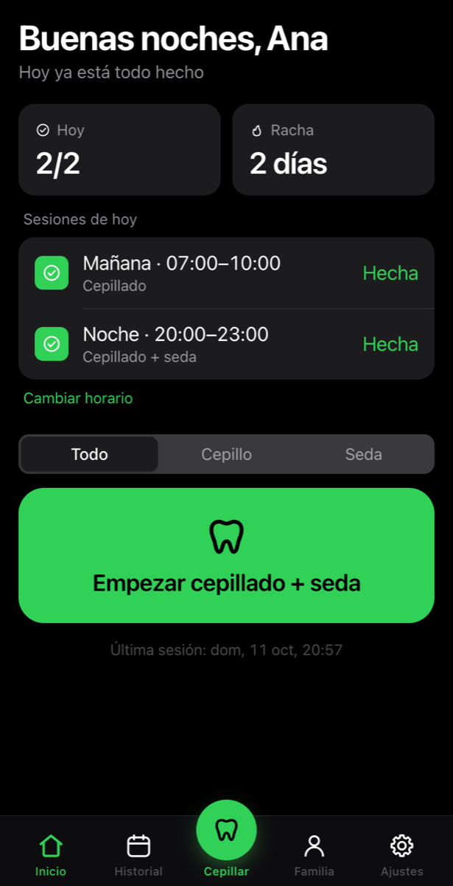
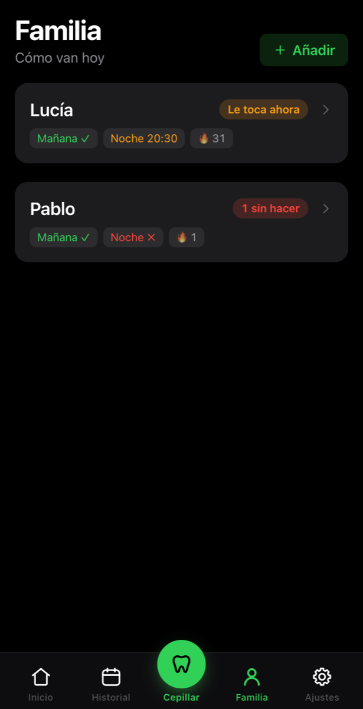
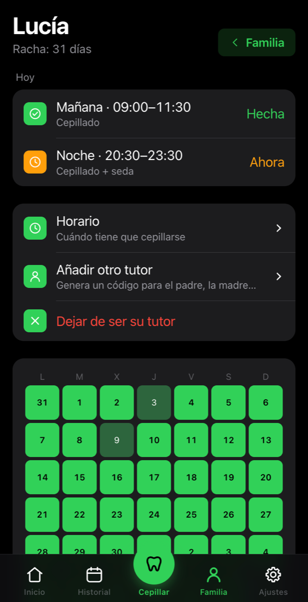
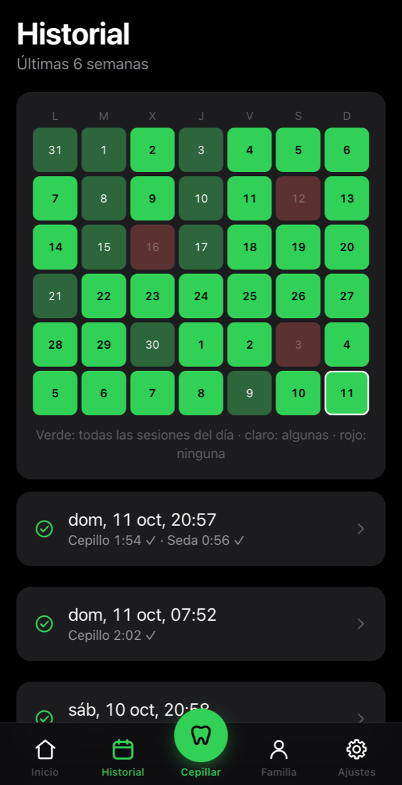
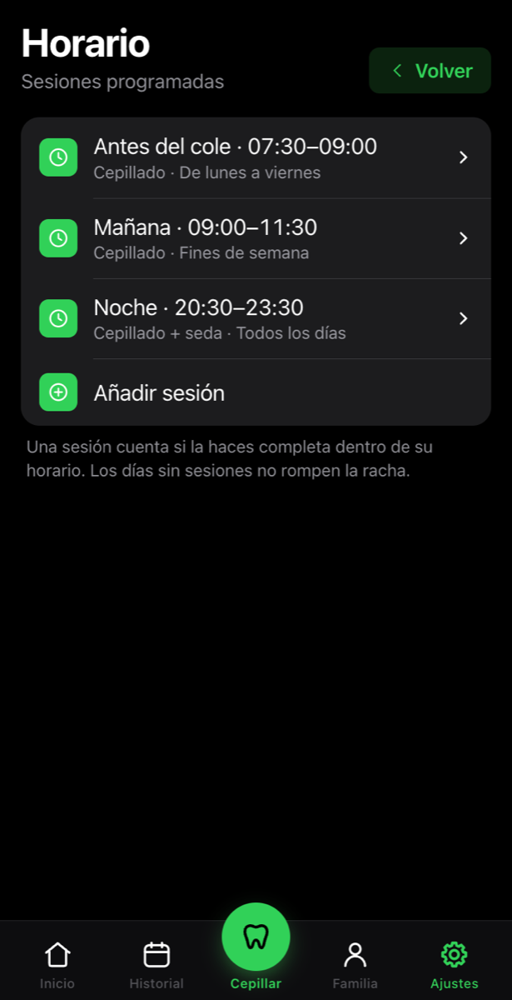

# flossy

Web app para el móvil que guía el cepillado y la seda dental con la cámara: te pide cada zona
(arriba/abajo × izquierda/centro/derecha) y su barra solo sube mientras el sistema confirma que
estás en ella. Cada persona de la casa tiene su perfil e historial.

<table>
  <tr>
    <td align="center"><br><sub><b>Sesión guiada</b>: zona a zona, con voz</sub></td>
    <td align="center"><br><sub><b>Inicio</b>: lo que toca hoy y la racha</sub></td>
    <td align="center"><br><sub><b>Familia</b>: cómo van los niños</sub></td>
  </tr>
  <tr>
    <td align="center"><br><sub><b>Ficha del niño</b>: hoy y su calendario</sub></td>
    <td align="center"><br><sub><b>Historial</b>: las últimas 6 semanas</sub></td>
    <td align="center"><br><sub><b>Horario</b>: una, dos o las sesiones que quieras</sub></td>
  </tr>
</table>

<sub>Capturas con datos de demostración.</sub>

## Estructura

| Carpeta | Qué es |
|---|---|
| `frontend/` | React + Vite. Diseño, componentes y login adaptados de [openGym](https://github.com/DuarteSantos8/openGym). |
| `api/` | Node sin framework: perfiles (passkeys + contraseña), cookie de sesión, historial. JSON en `data/`. |
| `vision/` | Python: detección en tiempo real por WebSocket (`app.py`) y el laboratorio para grabar, analizar y entrenar (`server.py`, `analyze.py`, `zones.py`). |
| `web/` | nginx: sirve la app y reenvía `/api` y `/ws` en el mismo origen. |

```
móvil ──HTTPS──▶ nginx ──/api──▶ api (Node)     ── data/ (usuarios, sesiones, secreto)
                       └─/ws───▶ vision (Python) ── lee data/secret + db.json para validar la cookie
                                                  └─ models/zones.joblib (clasificador de zonas)
```

## Horarios, familia y API

- **Horario**: cada perfil tiene sesiones programadas (franjas): nombre, hora de inicio y fin,
  días de la semana y qué toca (cepillado, seda o los dos). Una franja se cumple si dentro de ella
  se hace una sesión completa de ese tipo. Por defecto: mañana (07:00–10:00, cepillado) y noche
  (20:00–23:00, cepillado + seda). El estado se calcula en el servidor, en la zona horaria del
  navegador de cada persona.
- **Familia**: un tutor crea el perfil de un niño (nombre + contraseña) o se vincula a uno
  existente con un código de un solo uso (15 min) que genera el niño o el otro tutor. Los tutores
  ven el estado y el historial del niño y gestionan su horario; el niño ya no puede cambiarlo.
- **API de solo lectura** para domótica: claves creadas en Ajustes → Claves de API. Una clave
  ve a su dueño y a los niños de los que es tutor.

```bash
curl -H "Authorization: Bearer flossy_…" https://flossy.example.com/api/v1/status          # todos
curl -H "X-API-Key: flossy_…"            https://flossy.example.com/api/v1/status/lucia    # una persona
```

```jsonc
{ "id": "…", "name": "Lucía", "tz": "Europe/Madrid", "date": "2026-10-11",
  "ok": false,                       // false si hoy alguna franja ya pasó sin hacerse
  "open_now": 0, "missed_today": 1, "done_today": 1, "total_today": 2,
  "slots": [ { "id": "manana", "name": "Mañana", "start": "07:00", "end": "10:00", "mode": "brush", "status": "done" },
             { "id": "noche",  "name": "Noche",  "start": "20:00", "end": "23:00", "mode": "both",  "status": "missed" } ],
  "streak": 4 }
```

`status` de cada franja: `done`, `open` (ahora es su hora), `upcoming` o `missed`. Ejemplo en Home
Assistant: un sensor REST con `value_template: "{{ value_json.ok }}"` y una automatización que
apague la tele cuando pase a `false`.

## Grabaciones para entrenar

Desde la app (Ajustes → Grabar para entrenar) se graba siguiendo un protocolo: la app dice en voz
alta qué zona hacer y el servidor guarda cada fotograma etiquetado en `RECORDINGS_DIR` (volumen
`recordings/`), con el mismo formato que el laboratorio. Pueden grabar los administradores y los
perfiles a los que un administrador se lo active (Ajustes → Grabaciones).

Para entrenar en local (o simplemente `make train`, ver más abajo), con una clave de API de un
administrador:

```bash
cd vision
FLOSSY_KEY=flossy_… uv run fetch_recordings.py https://flossy.example.com   # baja las nuevas a data/recordings/
uv run analyze.py        # revisarlas
uv run zones.py          # reentrenar -> models/zones.joblib; commit + push y CI publica la imagen
```

API (solo administradores, cookie o `Authorization: Bearer <clave>`): `GET /ws/recordings` (lista),
`GET /ws/recordings/{id}.tar` (descarga), `DELETE /ws/recordings/{id}`.

## Requisitos del servidor

**No hace falta GPU.** Todo corre en CPU:

- Por fotograma (480×360): MediaPipe manos ~33 ms + cara ~10 ms + clasificador de zonas ~7 ms
  ≈ **50 ms de un núcleo** (medido en un M1 Max). A ~10 fps, **cada sesión activa usa ~0,5–1 núcleo**.
- Un Ryzen 9 de 16 núcleos aguanta de sobra varias sesiones a la vez (la familia entera cepillándose
  a la vez y sobra máquina).
- RAM: ~0,5 GB el servicio de visión + ~0,3 GB por sesión activa; la API y nginx, casi nada.
- Red: ~25 KB por fotograma ≈ **2 Mbit/s por sesión** de subida desde el móvil. Mejor en la wifi de casa.
- Disco: mínimo. Las sesiones guardadas son unos cientos de bytes cada una.
- **HTTPS obligatorio**: el navegador del móvil no deja usar la cámara ni las passkeys sin él.
  Pon flossy detrás de Caddy, Traefik, Cloudflare Tunnel, Tailscale Serve…

YOLO (detector del cepillo) queda fuera de la imagen de producción: casi nunca ve el cepillo
(lo tapa la mano) y costaba otros ~40 ms por fotograma y ~2 GB de PyTorch. Sigue disponible en el
laboratorio.

## Probarlo con Docker

Con las imágenes ya publicadas en ghcr.io, sin compilar nada ni configurar nada:

```bash
curl -O https://raw.githubusercontent.com/mangelajo/flossy/main/docker-compose.yml
docker compose up -d              # http://localhost:8080 en esta misma máquina
```

El primer perfil que se crea es administrador. Los datos quedan en `data/` (haz copia) y las
grabaciones para entrenar en `recordings/`. Funciona igual con Podman (`podman compose`).

- **Desde el móvil en la red de casa:** `docker compose --profile https up -d` añade HTTPS con un
  certificado autofirmado en el puerto 8443. Pon en `.env` `ORIGIN=https://<ip>:8443` y
  `RP_ID=<ip>`, y acepta el aviso del certificado en el móvil. Las passkeys no funcionan con un
  certificado así: entra con contraseña.
- **Despliegue de verdad:** detrás de un proxy con HTTPS para tu dominio (Caddy, Traefik,
  Cloudflare Tunnel, Tailscale Serve…) con `RP_ID` y `ORIGIN` de ese dominio en `.env`.
  Ver `.env.example` para el resto de opciones (invitaciones, contraseñas…).
- **Desde el código:** `make images` construye las imágenes y arranca con ellas.

## Desarrollo (`make`)

```bash
make install    # dependencias (npm, uv) y modelos (git lfs pull)
make dev        # api :3000 + visión :8001 + frontend http://localhost:5173 (datos en .dev-data/)
make            # lista todas las tareas
```

## Entrenar el detector de zonas

Con `FLOSSY_SERVER` en `local.mk` (no va a git) y una clave de API de administrador en
`~/.flossy-key`:

```bash
make train      # baja las grabaciones nuevas del servidor y reentrena -> vision/models/zones.joblib
make analyze    # resumen por zona de las grabaciones locales
make lab        # laboratorio de grabación del prototipo: https://<ip>:8443 en el móvil
```

Los modelos (`vision/models/*.task`, `zones.joblib`) van en git LFS y dentro de la imagen de
visión: tras reentrenar, haz commit de `zones.joblib` y CI publica una imagen nueva. En local, la
app recarga `zones.joblib` sola al empezar la siguiente sesión.

## Licencia

AGPL-3.0-or-later. Incluye código adaptado de openGym (© Duarte Santos, AGPL-3.0):
`api/password.js`, `api/rate-limit.js`, `api/durable.js`, `api/verify-error.js`, la autenticación de
`api/server.js`, y en el frontend `index.css`, `components/{Icon,ui,Modals,Toast}.jsx`,
`lib/{use-sheet-keyboard,native-keyboard,viewport-guard}.js` y la estructura de `views/Login.jsx`.
